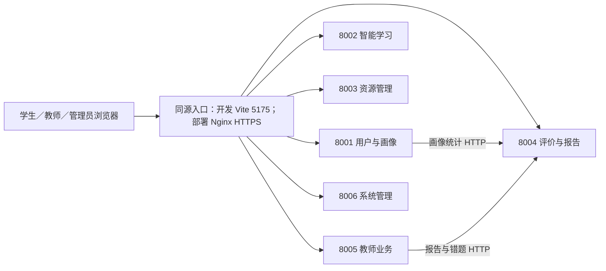

# 功能闭环与多端口互联优化方案

> 本文保留为专项分析记录。已合并至[项目统一优化实施方案](unified-optimization-plan.md)，实施范围、优先级及排期以统一版为准，不再与其他分项方案叠加计算。

日期：2026-09-16。基于当前工作区静态检查，未启动服务或验证当前端口连通性。本文补充总体优化方案，重点是三个角色之间的数据流和多服务联调。

## 1. 功能优先补齐哪些地方

| 优先级 | 功能 | 当前实现及不足 | 建议交付 | 验收场景 |
|---|---|---|---|---|
| P0 | 班级和成员管理 | TeacherManager 的班级保存在内存；学生洞察和教学统计忽略 class_id，查询所有活跃学生 | 持久化班级、教师归属、学生成员关系；所有统计和查询按成员过滤 | 建立两个班级，各班教师只能看到自己班的数据，重启后成员不丢失 |
| P0 | 教学范围发布 | 已有 TeachingScope 持久化和路径发布；学生范围查询将 student_user_id 为空的记录全部纳入，缺少班级成员约束 | 发布对象使用班级或指定成员；查询及路径发布都检查归属；保存发布版本和操作人 | 给 A 班发布内容，B 班学生不出现该内容，指定学生发布不影响同班其他人 |
| P0 | 作业发布与批改 | classes.py 中 assign_homework、review_homework 仅返回提交参数，没有完整持久化流程 | 增加作业、题目关联、提交、批改记录；明确草稿、已发布、已提交、待批改、已批改状态 | 教师发布→学生收到→提交→教师批改→学生查看反馈，刷新和重启后结果仍在 |
| P0 | 管理员修改角色 | SystemManager.assign_role 返回 updated，但不更新 users.role | 真实更新用户角色，审计记录落库；当前用户信息及权限及时刷新 | 修改后 /users/me 与实际接口权限一致；撤销教师身份后旧会话不能继续使用教师权限 |
| P1 | 管理配置生效 | 学科、配置和日志保存在内存；配置编辑没有明确运行时消费链路 | 配置持久化、类型校验、版本、适用服务、热更新或重启生效说明 | 修改设置后目标功能确实改变，且可以还原上一版本 |
| P1 | 资源状态及导出 | 资源列表和外部导入已使用数据库；状态仍在 _status_overrides 内存字典中；导出接口返回 downloads/{format} 地址，所查路由未实现该下载路径 | 状态字段落库；真正生成导出文件或返回导出任务；下载接口和前端处理统一 | 归档状态重启后保留；导出的 PDF/Word 可以下载打开，文件内容与课件一致 |
| P1 | 学习任务关联 | 已有路径、课件、练习、错题和报告，需要验证各功能之间稳定关联 | 用 path_id、task_id、resource_id、exercise_id、submission_id 关联；完成状态以服务端为准 | 从路径打开课件并答题后，路径进度、错题本、报告和教师端体现同一作答事实 |
| P1 | 故障下的功能表达 | 部分页面有示例资源回退；用户画像聚合失败可能回退为零值 | 区分无数据、示例、加载失败、过期缓存和真实结果 | 评估服务不可用时提示数据暂不可用，而不是把已有学习成果显示为零 |

源码依据：services/teacher_service/app/services/teacher_manager.py、services/teacher_service/app/api/routes/classes.py、services/system_service/app/services/system_manager.py、services/resource_service/app/services/resource_manager.py、services/resource_service/app/api/routes/resources.py、services/user_service/app/api/routes/users.py。

## 2. 当前端口与实际职责

| 端口 | 服务 | 当前主要职责 | 优化定位 |
|---|---|---|---|
| 5175 | Vue/Vite | 学生、教师、管理员页面；通过六个 VITE_* 地址请求后端 | 开发入口；增加同源代理 |
| 8001 | user-service | 登录、用户、画像；部分画像信息通过 HTTP 读取 8004 | 身份与画像接口 |
| 8002 | agent-service | 编排、生成、路径、答疑、图谱、聊天、知识库 | 智能学习计算入口 |
| 8003 | resource-service | 资源列表、导入、文件下载、状态、导出入口 | 资源管理和交付 |
| 8004 | evaluation-service | 提交评分、错题、报告、画像统计 | 学习评价事实与统计 |
| 8005 | teacher-service | 班级、教学范围、教学分析；HTTP 聚合 8004 | 教师业务入口 |
| 8006 | system-service | 角色、学科、配置、审计入口 | 管理员业务入口 |
| 8007 | agent-service-qa-compat | 启动与 8002 相同的完整 FastAPI 应用 | 确认旧客户端后改为兼容代理或移除 |
| 80 | Nginx | 已配置六类 API 代理，但没有前端静态站点配置 | 补齐部署入口，生产配置 HTTPS |

当前并非所有跨服务能力都经 HTTP 调用：协调器直接导入评价服务的 ReportService，并使用共享数据库。因此，端口健康不等于业务链路健康；8004 停止时也不能推断所有评价代码都停止执行。

另外，Compose 启动了 8010 的 Chroma 服务，但已查看的 rag.py 使用本地 PersistentClient，不能认为生成链路已经接入该容器。应明确选择本地嵌入式或 HTTP 服务模式，并确保导入、检索使用相同索引。

## 3. 推荐的统一入口

图中展示主要 HTTP 链路，不代表所有数据库、进程内调用与消息流。

浏览器统一使用相对 API 地址，开发环境经 Vite proxy，部署环境经 Nginx。内部保留 8001–8006，不要求合并服务，也不需要浏览器知道内部 IP 和端口。

建议采用以下新网关命名，迁移时保留现有复数前缀作为兼容别名，并逐步淘汰：

| 前端 baseURL | 请求路径示例 | 后端应收到 |
|---|---|---|
| /api/user | /users/login | 8001 /users/login |
| /api/agent | /resources/generate | 8002 /resources/generate |
| /api/resource | /resources | 8003 /resources |
| /api/evaluation | /evaluation/practice/submit | 8004 /evaluation/practice/submit |
| /api/teacher | /teacher/classes | 8005 /teacher/classes |
| /api/system | /system/configs | 8006 /system/configs |

网关只去掉服务前缀，例如 /api/user/users/login 去掉 /api/user 后保留 /users/login。当前 Nginx 的 /api/users/ 会整体替换为 /，因此 /api/users/login 会变成后端 /login；若沿用现有配置，客户端需要组合 /api/users/users/login。应以映射表固定规则，避免重复前缀和 404，不能仅替换主机地址。

8002 的资源生成和 8003 的资源管理都含 /resources，必须按服务命名空间分流。下载链接也需要包含正确网关前缀；不能让 /resources/{id}/download 被浏览器发到前端站点根路径。新增下载鉴权后，前端可用带令牌的 HTTP 请求取得 Blob，或使用短期签名下载地址。

## 4. 跨端口互联的具体改动

### 4.1 地址、环境和启动一致

- 区分监听地址与可访问地址。0.0.0.0 用于服务监听，不能写入浏览器 API 地址；其他电脑浏览器中的 127.0.0.1 指向其他电脑自身。
- 本机模式中内部地址可使用 http://127.0.0.1:8004；容器模式应使用 http://evaluation-service:8004。容器内 localhost 只指向该容器。
- common/config.py 当前读取 .env 时直接覆盖进程变量。改为明确的配置优先级：部署注入变量优先于本地文件，避免容器地址被本机配置覆盖。
- 启动脚本仅在 .env.local 不存在时生成地址，端口变化可能留下旧地址；增加配置一致性检查，不静默覆盖用户自定义配置。
- 目前脚本发现端口已监听就跳过。增加 /health 的服务身份校验和 /ready 的依赖检查，端口被其他进程占用时明确报错；Vite 设置严格端口避免自动漂移。
- 本地多进程与容器分别提供配置模板。Compose 添加真正的就绪检查，不能把 depends_on 的启动顺序当作依赖可用。
- 同源入口上线后，浏览器无需跨六个端口；仍支持直连开发时，CORS 精确列出实际前端协议、主机和端口。

### 4.2 服务身份和权限贯通

教师接口已有角色依赖，但教师调用评估服务时没有传递 Authorization；用户服务读取评估统计也存在同样问题。给 8004 补权限时必须同步改造调用端，避免原先可用的教师详情全部变成 401。

短期可在内部 HTTP 调用中传递经校验的用户令牌，并由接收端重新检查用户和班级归属；后续需要后台任务时再使用独立服务身份及受限授权范围。客户端传入的 user_id 或 teacher_id 不能代替授权。

所有调用传递 trace_id；日志至少记录调用方、目标服务、状态和耗时。不得记录访问令牌。

### 4.3 故障隔离与状态一致

TeacherManager 使用 asyncio.gather 并发获取三项数据，但单项网络异常可能导致整个详情失败。建议三个面板分别返回结果、错误和更新时间：错题失败不应阻止显示已取得的报告。为连接、读取、整个业务操作设置不同超时；只对幂等查询做有限自动重试。

角色修改、配置更新、资源状态和教学发布均以数据库为事实来源，避免多 worker 各有一份内存。前端缓存带版本及刷新策略，收到修改结果后重新获取真实状态。

### 4.4 明确服务边界

短期接受共享数据库和现有进程内调用，但明确各数据的写入责任：用户服务负责账户，教师服务负责教学组织，评价服务负责作答与评分，资源服务负责资源管理。智能体计算生成结果，不应让不同入口分别维护不一致的副本。

长期如需独立部署，再将协调器对评价实现的直接导入改为稳定客户端接口。不要在同一轮同时重写整个服务架构。

## 5. 联调验收：用三个角色完成一个真实场景

准备一个管理员、两名教师、两个班级及各班至少一名学生，在隔离测试库执行：

1. 管理员调整教师角色，刷新后权限正确，重启后角色保留。
2. 教师 A 创建班级并绑定学生，教师 B 看不到 A 班学生详情。
3. 教师 A 发布课件范围和作业，仅 A 班收到，B 班内容不变。
4. A 班学生从路径进入课件、完成练习并提交；系统保存答案、评分和错题。
5. 教师查看本班报告并批改，学生收到反馈，学习报告与路径状态同步。
6. 导出课件并打开文件，确认下载经网关成功且内容匹配。
7. 临时停止 8004，教师详情显示具体面板不可用，不显示错误的零分；恢复后可重新加载。
8. 重启 8003、8005、8006，资源状态、班级、作业、配置和角色不丢失。
9. 从另一台设备仅通过统一入口访问，浏览器请求中没有访问自身 localhost 或服务器内部端口。
10. 对六组网关映射分别验证正常、未登录、无权限、路径不存在和后端不可用响应。

## 6. 落地顺序与工作量

| 阶段 | 重点 | 粗估工作量 |
|---|---|---|
| A | 固定路由映射、Vite/Nginx 同源入口、环境隔离、启动检测 | 2–4 人天 |
| B | 班级成员与归属、教学范围隔离、真实角色更新 | 4–7 人天 |
| C | 作业发布/提交/批改、资源状态与真实导出 | 6–10 人天 |
| D | 服务调用鉴权、局部降级、跨端口与跨角色端到端测试 | 3–5 人天 |

合计约 15–26 人天，为初步估算，与总体方案部分工作重叠，不应简单相加。建议首先交付“统一入口 + 班级隔离 + 真实作业闭环”，它们最直接影响项目是否真正可用。

需要同步修订旧 docs/data-flow.md：其中“资源管理仍是内存骨架”等描述已落后于当前数据库实现。以实际代码逐项校准，避免把已有能力重复规划或把接口回显误当作功能完成。
