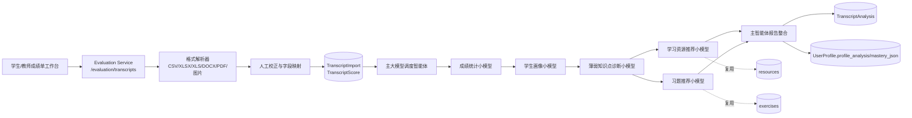
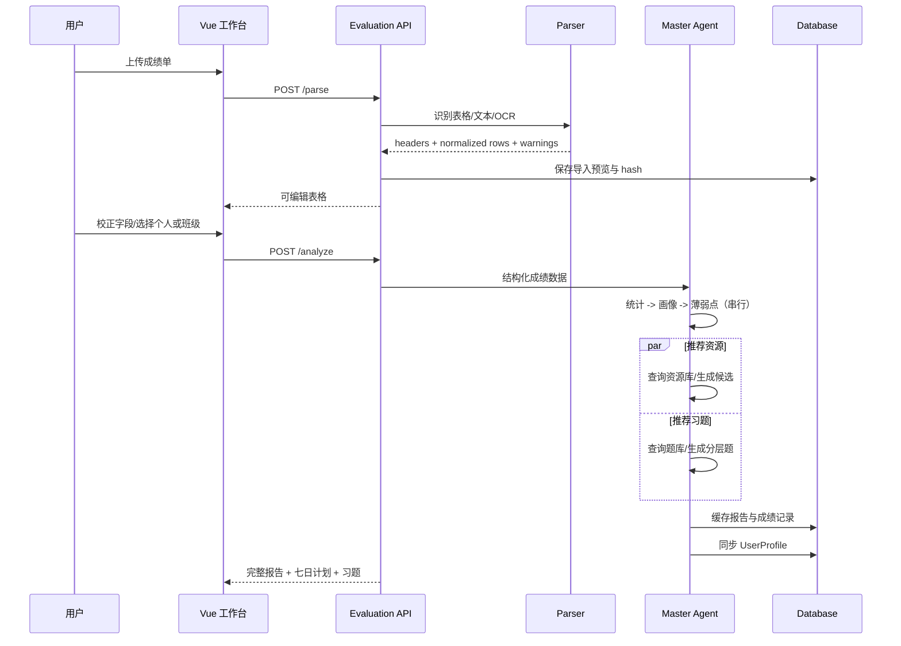

# 成绩单智能解析与分层学情推荐模块

本模块在既有 FastAPI 评价服务中增量实现，复用现有用户、画像、资源和题库表，不新增平行服务或替换原有学习报告链路。

## 1. 整体架构



没有配置 LLM 凭据时，`TranscriptAnalysisOrchestrator` 使用可审计的确定性统计降级；结构化输出、串并行拓扑、数据质量标签和“仅供参考”提示保持不变。配置模型后可将各 agent 方法替换为严格 JSON 的模型调用，不改变 API 契约。

## 2. 数据库表设计

| 表 | 关键字段 | 用途 |
|---|---|---|
| `transcript_imports` | `owner_user_id`, `file_name`, `content_hash`, `field_mapping_json`, `normalized_rows_json`, `quality_score`, `warnings_json` | 文件解析预览、去重缓存、人工校正结果 |
| `transcript_scores` | `import_id`, `student_user_id`, `student_no`, `student_name`, `class_name`, `subject`, `score`, `max_score`, `exam_date`, `confidence_json` | 可检索的标准化成绩记录，支持班级/个人维度 |
| `transcript_analyses` | `import_id`, `owner_user_id`, `scope`, `cache_key`, `result_json`, `report_text`, `data_quality` | 多智能体结果、报告、缓存与历史查询 |
| `user_profiles`（既有） | `profile_analysis`, `mastery_json`, `learning_style` | 成绩单分析结果同步到原有学情画像 |

正式迁移：`alembic/versions/20261014_0006_transcript_analysis.py`。本地服务仍由既有 `ensure_database_schema()` 自动建表。

## 3. API 接口

| 方法 | 路径 | 权限 | 说明 |
|---|---|---|---|
| `POST` | `/evaluation/transcripts/parse` | 登录用户 | 上传并解析文件，仅产生可校正预览；限制 20MB |
| `POST` | `/evaluation/transcripts/analyze` | 学生/教师/管理员 | 提交校正后的二维结构化数据；`scope=class` 仅教师/管理员 |
| `GET` | `/evaluation/transcripts/history` | 登录用户 | 查询当前账号最近 30 条分析 |
| `GET` | `/evaluation/transcripts/analysis/{id}` | 资源所有者 | 查看完整结构化结果与报告 |
| `POST` | `/evaluation/transcripts/chat` | 资源所有者 | 基于持久化报告继续追问 |
| `GET` | `/evaluation/transcripts/analysis/{id}/export?format=pdf\|docx\|html\|markdown` | 资源所有者 | 导出报告；PDF/Word 依赖可选化失败时明确返回 503 |
| `POST` | `/evaluation/transcripts/analysis/{id}/share` | 资源所有者 | 生成不可枚举的 opaque 分享 token |
| `GET` | `/evaluation/transcripts/shared/{token}` | 持 token | 读取分享报告；生产环境可在网关增加过期/撤销策略 |

解析输出包含 `field_mapping`、`quality_score`、`warnings` 和 OCR 的 `low_confidence_cells`；置信度低于 0.8 的单元格由前端以黄色标记，分数越界、空行和重复行在提交分析前被清洗。

## 4. 核心业务时序



## 5. 智能体输出契约与优化 Prompt

主调度器必须只做路由、校验和整合。每个小模型只输出 JSON，不输出长文本。推荐的系统 Prompt：

```text
你是成绩单分析主调度智能体。你只能调度以下专用智能体：
score_statistics_agent, student_profile_agent, weakness_diagnosis_agent,
learning_resource_agent, exercise_recommendation_agent。

执行规则：
1. 先校验输入字段、分数范围、满分和数据质量；非法行不得进入统计。
2. 按依赖串行调用：成绩统计 -> 学生画像 -> 薄弱知识点。
3. 薄弱知识点和画像完成后，并行调用资源推荐、习题推荐。
4. 任一调用失败时重试一次；仍失败则使用 deterministic fallback，并在
   orchestration.fallback 和 report.quality_note 中标注，不得编造“已匹配”资源。
5. 只有存在大题/章节分时才能输出知识点级结论；只有总分时降级为科目/章节级，
   confidence <= 0.8，并明确“仅供参考”。
6. 严格输出 JSON，数值必须可由输入成绩复算，百分比范围为 0-100。

最终 JSON 必须包含：score_statistics、student_profile、weakness_diagnosis、
resource_recommendations、exercise_recommendations、report、data_quality、orchestration。
```

小模型 Prompt 的共同约束：`输入 JSON -> 输出 JSON Schema -> 禁止自然语言段落 -> 禁止随机数据 -> 缺少证据就降低粒度`。资源和题目优先按 `knowledge_point` 查询既有数据库，空结果才标注“可由大模型生成”。

## 6. 前端页面原型

`/student/transcripts` 和 `/teacher/transcripts` 共用 `TranscriptAnalysisView.vue`：

1. 顶部上传区：格式提示、文件大小约束、个人/班级切换；
2. 解析校正区：展示二维表，任意单元格可编辑，低置信度单元格高亮，展示清洗警告；
3. 报告区：整体均分、学习风格、优势/薄弱学科、失分原因、薄弱知识点；
4. 推荐侧栏：7 天计划、基础/提升/拔高题比例、PDF/Word 导出、报告追问；
5. 教师入口沿用同一 API，选择班级分析后输出全班统计、分层建议和 `student_reports`（按学号/姓名拆分的个人报告结果）。

## 7. 验证与边界

- 新增单测覆盖 CSV 字段映射、越界/重复清洗、串并行 agent 契约、持久化和画像同步。
- 图片 OCR 需要 Pillow、pytesseract 及本机 Tesseract 语言包；不可用时接口明确提示，不伪造 OCR 结果。
- 原生 PDF 读取使用 pypdf；扫描 PDF 需要 OCR 引擎，当前无可用引擎时返回可操作错误。
- 原始上传文件不落盘，只保留结构化成绩与结果；接口按 JWT 校验资源所有者，解析/分析写入既有 `audit_logs`。生产部署如需保留原文件，应将对象存储密钥托管在 KMS，并在入库前加密。
- 当前仓库既有历史 SQLite 可能没有 Alembic baseline；部署前按既有兼容 bootstrap 规则注册 baseline，再执行 `alembic upgrade head`，不要删除数据库绕过迁移。
