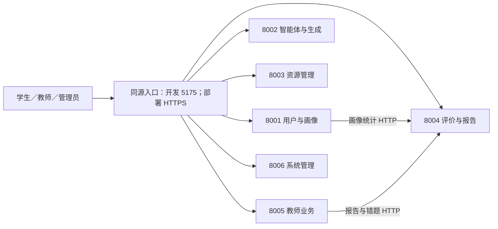

# 项目统一优化实施方案

更新日期：2026-09-16。

本文合并《项目优化方案》和《功能闭环与多端口互联优化方案》，作为后续实施、拆分任务和验收的统一依据。原两份文档保留为分析记录；优先级、实施顺序和排期以本文为准。

分析基于当前工作区源码，尚未启动服务、执行回归测试、端口联调或性能压测。以下区分已确认的代码问题、需要验证的业务链路和建议目标，不代表优化已经完成。

## 一、优化目标与范围

目标是让学生、教师、管理员通过统一入口完成可持久化、可追溯的教学学习流程：

> 管理员配置身份与权限 → 教师建立班级、发布教学范围和作业 → 学生按路径学习、答疑、练习与提交 → 系统评价并更新画像 → 教师查看报告和批改 → 学生获得反馈并调整后续学习。

保留 Vue 3、Python/FastAPI 和现有 LangGraph 主链路。优先补齐真实业务闭环和跨服务一致性，在基线验证后逐步增加异步任务、检索增强和性能优化。

本轮暂缓：全面 Java 迁移、通用智能体插件平台、完整事件驱动架构重写、默认多版本课件生成。需要新增数据库表和字段时，使用可审查的迁移，先保护已有学习记录。

## 二、当前实现的统一判断

| 领域 | 已有能力 | 主要缺口 |
|---|---|---|
| 学生学习 | 画像、路径、课件、练习、答疑、错题、报告 | 跨模块关联和恢复需要端到端验证；掌握度公式需校准 |
| 教师教学 | 教学范围持久化、真实答题统计、报告聚合 | 班级内存化；部分查询忽略班级；作业与批改仅回显参数 |
| 管理后台 | 角色、学科、配置、日志接口 | 角色未实际更新用户表；配置与日志多为内存态 |
| 资源管理 | 主课件生成已入库；资源查询、外部导入和原文件下载 | 状态内存化；导出链接未形成完整文件交付 |
| 多服务访问 | 六个业务服务；已有 Nginx API 代理 | 前端默认直连多个端口；开发与容器配置、代理路径和调用授权未统一 |
| 生成审核 | 已有审核器和重试函数 | 主流程未接入该审核函数；另一入口重试仍审核旧内容；不可用可能被视为通过 |
| 多智能体 | 既有 LangGraph 路由及同步组合执行 | 同步执行前仍投递队列，状态含义不清；异步恢复机制不完整 |

重要校正：协调器调用 `generate_courseware_with_plan`，该函数通过 `_persist_generated_resource` 保存课件，但未调用 `_audit_and_retry_courseware`。不能再使用“主生成链路不落库”的旧文档描述，也不能以“存在审核函数”推断主生成流程已经审核。

## 三、统一任务清单

优先级定义：P0 为正确性、数据隔离及核心联调前置条件；P1 为可用业务闭环；P2 为质量、效率及维护性提升。阶段用于安排先后，不能只按优先级跳过依赖。

| 编号 | 优先级 | 工作包 | 具体交付 | 主要依赖 | 验收要点 |
|---|---|---|---|---|---|
| U01 | P0 | 身份校验与角色生效 | 删除 JWT 不验证签名的依赖降级；统一 401；角色写入 users；审计落库；评估旧密码哈希迁移 | 无 | 篡改、过期令牌拒绝；角色变更后实际权限及时变化 |
| U02 | P0 | 班级成员与对象授权 | 班级、教师归属、学生成员持久化；查询、发布、资源和任务按归属过滤；客户端 user_id 不作为授权依据 | U01 | 两班相互隔离；重启后关系保留；指定学生发布不影响其他学生 |
| U03 | P0 | 统一入口与地址配置 | Vite/Nginx 同源代理、六服务映射、内部地址模板、启动身份与就绪检查、8007 兼容策略 | 无 | 同一套业务路径支持本机和容器；另一台设备无需访问内部端口 |
| U04 | P0 | 服务间鉴权与故障隔离 | 8001→8004、8005→8004 传递身份与 trace_id；接收端校验范围；聚合面板独立失败 | U01、U02、U03 | 加固 8004 后合法调用仍成功；单个下游失败不让整页报错 |
| U05 | P0 | 统一生成与审核入口 | 主生成流程接审核；审核当前候选；修复重试模型参数、耗尽处理和 variants 一致性；三态审核 | 无 | 未审核或审核失败内容不能当作合格成品；主版本与变体一致 |
| U06 | P0 | 执行模式与状态语义 | 同步执行不再顺带投递执行消息；定义 task_id、幂等键和执行状态；部分失败明确返回 | 无 | 已投递不等于已完成；同一业务请求不会因双路径重复执行 |
| U07 | P1 | 作业发布、提交与批改 | 作业、题目引用、提交、批改持久化；学生待办和反馈；教师班级内批改 | U02、U04 | 教师发布→学生提交→教师批改→学生查看反馈完整通过 |
| U08 | P1 | 资源管理与交付 | 状态持久化；资源版本和归属；真实 PDF/Word 导出及授权下载；保留已有导入能力 | U02、U03、U05 | 重启不丢状态；文件可打开且内容正确；下载走正确代理 |
| U09 | P1 | 学习记录与掌握度 | 统一路径、任务、资源、题目、作答关联；幂等提交；校准公式；画像聚合可重建 | U02、U06 | 重复不重复计分，并发不丢更新；慢答和超时行为符合定义 |
| U10 | P1 | 报告与路径反馈 | 数值由程序统计；建议带证据和版本；明确路径调整触发和实际执行方式 | U07、U09 | 学生与教师统计一致；调整可解释且真正落库 |
| U11 | P1 | 配置与管理操作闭环 | 学科、配置、日志持久化；配置校验、版本、生效范围和回滚；页面刷新真实状态 | U01、U03 | 保存后实际功能变化；重启保留；敏感值不进入日志 |
| U12 | P1 | 长任务与消息恢复 | 按测量结果迁移长操作；任务持久化、轮询恢复；发布确认、消费幂等、有限重试、死信及必要的事务发件箱 | U04、U06 | 已受理任务重启可查询；重复消息不产生重复业务结果 |
| U13 | P2 | 知识库与生成质量 | 知识点统一 ID、来源与索引版本；学科约束；引用；固定评价集；按评估决定混合检索与重排 | U05、U09 | 相同样本可对比质量；索引可回滚；引用可核对 |
| U14 | P2 | 模型耗时与成本 | 统一调用预算、分阶段耗时和用量；总截止时间、有限重试；按需变体及版本化缓存 | U05、U06；异步场景依赖 U12 | 不以跳过审核换速度；缓存不跨用户泄漏；重试不成倍叠加 |
| U15 | P2 | 前端状态与维护 | 拆分复杂页面职责；统一错误和任务状态；区分无数据、示例、失败及缓存；校验 API 类型 | U03；随 U07–U12 增量完成 | 刷新恢复状态；失败不伪装成零分或真实学习内容 |
| U16 | P0 起步、持续 | 测试、观测与文档 | 隔离测试数据、核心回归、代理契约、前端构建、迁移检查、闭环 E2E、trace_id 与文档校准 | 从首阶段开始 | 每阶段都有证据；文档与实际路由、运行版本一致 |

## 四、多端口互联的统一设计

### 4.1 入口与职责

此图表达目标入口和主要 HTTP 链路。当前还有共享数据库和进程内直接调用，不能把图理解为全部依赖已经网络化。协调器直接导入 ReportService 的边界先登记，再按独立部署需要逐步替换。

### 4.2 固定代理映射

| 前端 baseURL | 页面请求路径 | 代理后的目标 |
|---|---|---|
| /api/user | /users/login | 8001 /users/login |
| /api/agent | /resources/generate | 8002 /resources/generate |
| /api/resource | /resources | 8003 /resources |
| /api/evaluation | /evaluation/practice/submit | 8004 /evaluation/practice/submit |
| /api/teacher | /teacher/classes | 8005 /teacher/classes |
| /api/system | /system/configs | 8006 /system/configs |

只剥离服务前缀，保留后端原路由；例如完整请求 /api/user/users/login 转为 /users/login。8002 和 8003 都存在 /resources，必须用服务前缀区分。旧 Nginx 复数前缀在迁移期保留兼容映射，验证后再淘汰。

下载接口也遵守上述映射，不能向浏览器返回无法定位服务的裸路径。生产入口补静态资源、前端路由回退和 HTTPS；业务 API 错误不得被前端页面回退掩盖。

### 4.3 环境和联通性约定

1. 浏览器使用相对地址；服务内部调用按部署模式配置。本机可用 127.0.0.1，容器用 evaluation-service 等服务名。
2. 监听地址与访问地址分离，0.0.0.0 不写入客户端地址；跨设备访问不依赖浏览器自身 localhost。
3. 修复 .env 覆盖部署环境变量的问题，明确“部署变量优先、本地文件补充”。前端旧 .env.local 与端口配置不一致时提示具体差异。
4. 启动检查服务身份和依赖就绪，不只检查端口监听；区分 /health 与 /ready；Vite 使用固定端口；Compose 等待实际就绪。
5. 8007 当前是重复启动的完整 agent-service。先调查旧调用方，再改兼容代理或停用，避免直接删除造成兼容故障。
6. Chroma 明确选择本地 PersistentClient 或服务模式；当前 Compose 的 8010 与代码本地索引不能视为已接通。导入和检索必须使用同一模式和版本。
7. 用户身份仅传给配置且可信的内部目标；接收端独立校验权限。日志串联 trace_id，不记录令牌。
8. 前端、网关、服务调用与模型调用的超时按业务总预算配置，避免网关先超时而后台持续生成。写操作需幂等后才能考虑重试。

## 五、功能与数据闭环约定

### 5.1 教学和学习关联

拟新增或补齐以下关系，最终表名按现有模型和迁移约定确定：

| 数据 | 必要关联 | 责任模块 |
|---|---|---|
| 班级、成员、教师归属 | class_id、teacher_id、student_id | 教师服务 |
| 教学范围、作业、题目引用 | class_id、scope_id、assignment_id、exercise_id | 教师服务 |
| 作业提交和批改 | assignment_id、submission_id、student_id、reviewer_id、版本 | 教师业务；评分复用评价能力 |
| 资源与导出 | resource_id、owner_id、版本、审核状态、导出状态 | 资源服务；智能体提供生成结果 |
| 学习任务与作答 | path_id、learning_task_id、resource_id、exercise_id、answer_id | 路径与评价模块按写入责任维护 |
| 执行任务 | execution_task_id、request_id、幂等键、状态、错误、结果引用 | 编排模块 |
| 画像、报告与建议 | user_id、证据记录、算法版本、生成时间 | 用户与评价模块明确分工 |

区分“学习任务”和“后台执行任务”，避免两者都使用 task_id 却含义不同。明确字段语义后再做兼容迁移。

作业状态与学生提交状态分别建模：作业可以是草稿、已发布、已关闭；每份提交可以是待提交、已提交、待批改、已批改。教师修改批改结果需要保留版本和修改理由。

### 5.2 生成与执行状态

执行状态至少区分 queued、running、succeeded、failed；多智能体部分失败单独表达。审核状态使用 passed、rejected、unavailable。不能用任务成功代替内容审核通过。

主生成流程统一完成计划、检索、生成、审核和持久化。候选内容如果提前保存，必须标明草稿；只有审核合格才进入正式展示状态。统一主课件与 variants，避免两条入口质量标准不同。

同步调用不依赖执行消息投递。需要异步时，由持久任务和可靠消费者负责，事务发件箱解决确有需要的“业务写入成功、事件发送失败”问题。目前未在所查目录发现完整消费确认循环，不能声称已经发生重复消费。

### 5.3 掌握度、画像和路径

当前分数范围为 0–100，而单次最高增加约 0.24；答题用时达到上限后无论对错均不更新。先用固定样例定义预期行为，再调整公式，不能只放大系数。用时不能抹掉错误证据，部分得分应有清晰作用。

答题记录作为事实来源；画像保存聚合、近期窗口和证据版本，历史不无限堆入 JSON。增加幂等和并发更新保护，支持重建。自述偏好、测评结果和行为证据分开，报告数值由程序统计。

路径调整应能追溯触发证据与版本，并验证实际执行。只发送 PathAdjustmentRequest 不能当作路径已经更新；消费者未就绪时使用明确、可验证的同步流程或显式待处理状态。复习间隔调度与掌握度估计分别评估。

## 六、实施阶段与统一排期

以下为重新去重后的范围估算，替代两份分项文档的排期。以 2 名开发人员、兼职测试和教学评审为假设，预计约 7–10 个日历周；约 56–84 人天。第一阶段建立测试基线后应重新估算，外部模型等待和上线窗口可能影响工期。

| 阶段 | 建议时间 | 工作包与交付 | 阶段退出条件 | 估算 |
|---|---|---|---|---|
| A：可信基础和联调入口 | 第 1–2 周 | U01–U06；U16 建立基线。完成权限、班级关系、代理、主流程审核与执行语义 | 权限隔离、六组代理映射、内部授权调用、审核故障用例通过 | 16–22 人天 |
| B：完整业务闭环 | 第 3–5 周 | U07–U11；U15 按功能同步。作业、资源交付、画像评价、路径反馈、管理生效 | 三角色全流程通过；核心数据重启不丢失 | 20–30 人天 |
| C：可恢复运行 | 第 6–7 周 | U12、U14 基础监测；补齐局部失败处理和跨设备验证 | 重启恢复、重复请求、下游故障注入通过 | 10–16 人天 |
| D：质量与交付优化 | 第 8–10 周内按结果收敛 | U13、U14 优化、U15 剩余拆分、U16 全面验收 | 固定样本质量对比、构建、迁移和端到端回归通过 | 10–16 人天 |

U16 的测试和文档工作计入各阶段，不单独重复计算。只有任务依赖满足后才能推进后续工作包。

若近期目标是演示或试用，优先交付 A+B 的最小闭环，资源导出先完成一个真实格式。复杂检索、自动熔断、额外课件风格和大范围页面拆分可后置，但不能省略身份校验、班级隔离和真实状态。

## 七、统一验收清单

准备隔离测试库：一个管理员、两名教师、两个班级、每班至少一名学生。先用可控模型替身验证系统行为，再用小规模真实模型样本验证内容质量。

| 场景 | 必须满足的结果 |
|---|---|
| 身份和角色 | 篡改与过期令牌失败；角色变更后 /users/me、页面和接口权限一致 |
| 班级隔离 | A 班教师和学生不能读取、修改 B 班私有数据；发布范围准确 |
| 三角色闭环 | 管理员授权→教师发布→学生学习提交→系统评分→教师批改→学生反馈及路径更新 |
| 资源交付 | 合格课件可追溯审核结果；导出文件能打开；归档和版本重启后保留 |
| 幂等和并发 | 重复提交与消息重放不重复计分；并发答题不覆盖彼此结果 |
| 六服务代理 | 每组映射覆盖正常、401、403/按策略的404、路径不存在、后端不可用；API 错误不返回 HTML 页面 |
| 跨设备访问 | 浏览器只使用统一入口；下载和长任务状态查询均成功 |
| 下游故障 | 停止 8004 时，依赖它的面板明确不可用，其他可用面板正常；不把失败显示为零成绩 |
| 重启恢复 | 班级、角色、配置、资源状态、作业及已受理任务不静默丢失 |
| 审核异常 | 首轮拒绝后审核新内容；异常和非法输出标为 unavailable；耗尽重试不发布为合格内容 |
| 学习反馈 | 固定正确、错误、部分得分、慢答和超时序列行为符合预先制定的规则；历史报告可核对 |
| 知识质量 | 至少 50 条检索样本和 30 份课件样本进行固定对比；来源及版本可追踪，结论注明样本限制 |

性能目标先设为同模型、同负载下生成 P95 比基线下降 20%，单位合格课件用量下降 15%；均为待基线确认的优化目标，不是当前结果或发布承诺。统计需要同时报告成功率、审核通过率和教师抽检质量，避免通过排除失败请求美化指标。

## 八、改动入口与交付物

| 改动领域 | 主要代码位置 |
|---|---|
| 身份、配置 | common/security/auth.py、common/dependencies.py、common/config.py |
| 网络与启动 | web-app/src/api/http.ts、web-app/vite.config.ts、infrastructure/nginx/nginx.conf、scripts/start_local_services.ps1、docker-compose.yml |
| 教师与后台 | services/teacher_service/app/api/routes/classes.py、services/teacher_service/app/services/teacher_manager.py、services/system_service/app/services/system_manager.py |
| 生成与编排 | services/agent_service/app/agents/coordinator.py、services/agent_service/app/services/resource_generation.py、audit_service.py、llm_factory.py |
| 资源与评价 | services/resource_service/app/api/routes/resources.py、services/resource_service/app/services/resource_manager.py、services/evaluation_service/app/services/profile_updater.py、report_service.py |
| 消息、检索与前端 | common/messaging/rabbitmq.py、services/agent_service/app/services/rag.py、web-app/src/views/、web-app/src/api/types.ts |
| 数据与测试 | common/models/learning.py、alembic/versions/、tests/、后续新增的 CI 配置 |

每个工作包交付：实现代码、必要的数据迁移、针对性测试、接口契约变更及验证记录。发布前检查兼容性，采用分步迁移和旧接口过渡；保留回退所需版本与数据备份，避免破坏已有作答事实。

最终同步 README、functionality、system-full-guide、data-flow 和旧 roadmap 中的实现状态、端口与运行版本。原有“资源管理仅内存实现”“主课件不落库”“报告完全依赖 LLM”等过时描述应按源码校正。

后续开发按 U01–U16 引用本方案，新增需求先更新范围与验收标准，避免维护多份相互冲突的实施计划。
