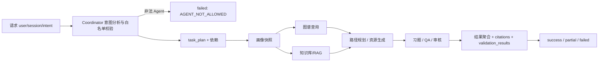
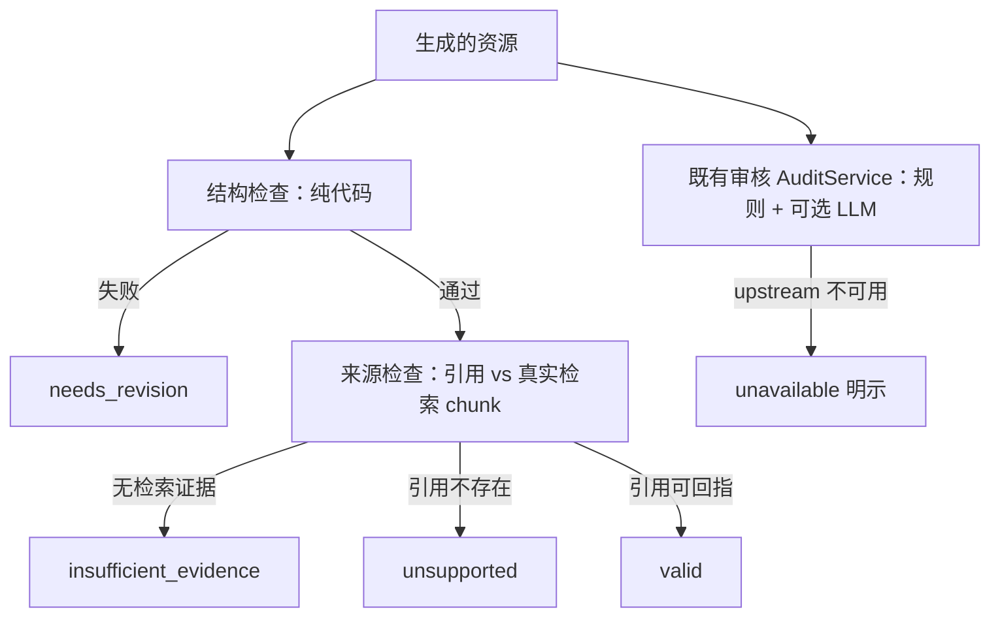
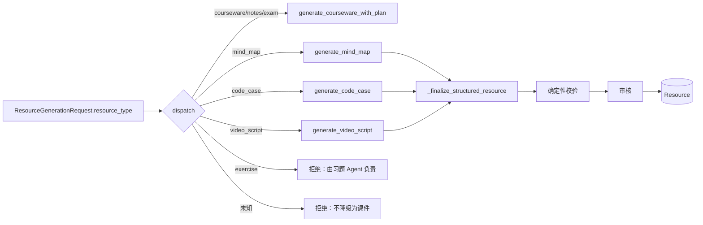
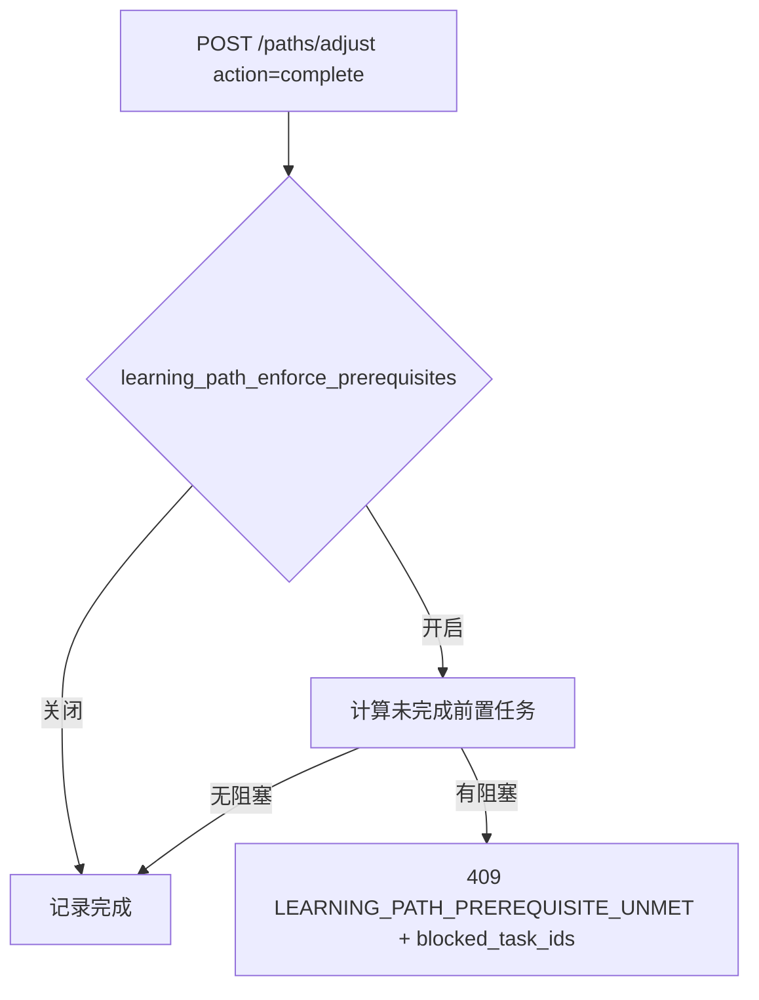

# 上游融合后的目标架构

> 本文描述 LearnMate + ZhiShu 融合后的服务边界、数据流与接口变化。
> 两个上游均无许可证，因此本文只描述**在当前项目内重新实现**的设计，不含上游代码。
> 逐项取舍见 [`upstream-integration-matrix.md`](upstream-integration-matrix.md)。

## 1. 责任边界（不变）

当前 FastAPI 多服务 + Vue 3 仍是运行基线。本次融合**没有**新增服务、没有替换数据库、
没有引入第二套向量库或认证系统。

| 层 | 主责任 | 本次融合 |
|---|---|---|
| Vue 3 | 页面、认证状态、加载/部分失败展示 | 补齐新资源类型标签与结构化字段类型；路径依赖字段类型 |
| user-service | 用户、画像事实、画像对话和权限 | 不变（ZhiShu 兼容视图已在前期接入） |
| agent-service | Coordinator、画像快照、RAG、资源/习题/QA、路径 | 统一任务状态补全；确定性校验层；三类新资源生成器；路径解锁门禁 |
| evaluation-service | 答题事实、错题、报告和建议 | 不变（仍是报告事实来源） |
| resource-service | 资源持久化、交互、推荐 | `type` 契约放开为开放字符串，保证历史行可读 |
| teacher/system-service | 班级范围、管理员配置和审计 | 不变 |

## 2. 统一任务状态

`CoordinatorState` 已包含全部要求字段，本次修复的是**执行阶段不得丢弃其中一部分**。



对外状态字段（`_build_task_state`）**始终全部存在**，消费方无需区分"缺失"与"为空"：

```json
{
  "user_id": 7,
  "task_id": "uuid",
  "session_id": "",
  "intent": "courseware resource generation",
  "intent_params": {},
  "learner_profile": { "mastery_score": 62, "correct_rate": 58, "answered_count": 7 },
  "learning_evidence": [],
  "selected_agents": ["learner_profiling_agent", "resource_generation_agent"],
  "task_plan": [],
  "agent_handoff": {},
  "intermediate_results": { "learner_profiling_agent": "completed", "resource_generation_agent": "completed" },
  "citations": [{ "marker": "[来源:c1]", "chunk_id": "c1", "resolved": true, "source": "kb/course.md" }],
  "validation_results": [{ "agent": "resource_generation_agent", "verdict": "valid", "structure_passed": true, "source_passed": true, "source_coverage": 0.5 }],
  "status": "success",
  "progress": 1.0,
  "current_step": "任务完成",
  "error": null
}
```

### 2.1 修复的真实缺陷

`_execute_agents`（`execute=True` 的同步分支）此前用只含 `task_id/status/progress/current_step/error`
的字典**整体覆盖**了 `run()` 产出的 `task_state`，导致 `execute=True` 时 `selected_agents`、`intent`、
`task_plan`、`learner_profile` 全部丢失。现在改为**合并**（`{**result["task_state"], ...}`）。

### 2.2 脱敏约束

- `learner_profile` 在任务状态中只保留下游 Agent 真正消费的事实白名单
  （掌握度、正确率、作答数、薄弱题型、学习风格、教师范围等），**不含**原始作答文本或对话。
- `agent_calls[].input_summary` 只记录字段名和布尔存在性；`prompt`/`token`/`authorization`
  被显式排除。完整 Prompt、密钥和私密对话不进入普通日志。
- 未向状态中加入模型隐藏推理链。

## 3. 确定性内容校验（本次新增的核心能力）



模块：`services/agent_service/app/services/content_validation.py`。

**这一层与既有审核分工不同**：审核回答"内容是否切题、是否可接受"，本层回答
"产物在结构上是否完整、是否真的锚定在本次检索到的证据上"。本层**不调用模型**，
因此结论可复现，且"模型没接通"永远不会被报告成"校验通过"。

### 3.1 结构检查项（按资源类型）

| 资源类型 | 检查 |
|---|---|
| `courseware`/`notes`/`exam` | 最小长度、必需章节（≥3/5）、无生成失败文本、无占位符、未截断 |
| `exercise` | 必填字段、选择题选项数 ≥2 且不重复、**答案必须落在自己的选项内**、题干不重复、无占位符、答案/解析非空 |
| `mind_map` | 节点非空、节点 id 唯一、**每条边的 source/target 都必须存在于 nodes**、无占位符；Mermaid 形态另检查声明了图类型、括号成对 |
| `code_case` | 必填字段、示例代码非空、`run_steps` 可执行、**拒绝 `executed`/`sandbox_output` 断言**、无占位符 |
| `video_script` | 章节非空、每章旁白非空、时长为正、**声明的总时长与各章之和一致**、**拒绝 `video_path`/`video_url` 等媒体字段** |

答案—选项一致性使用三种真实存在的形式解析：原样文本、字母键（`A`/`A.`/`A、`）、1 起始序号。

### 3.2 来源检查语义

三种结果被刻意区分：

- **`insufficient_evidence`**：本次没有检索到任何 chunk。系统不得声称有来源。
- **`unsupported`**：检索到了 chunk，但正文没有引用它们，或引用了不存在的 chunk id。
  **伪造的引用比没有引用更糟**，因此不存在的 id 会被显式记录为 `resolved=false` 而非静默丢弃。
- **`valid`**：结构与来源均通过，`source_coverage` 为"被引用的真实 chunk / 可用 chunk"。

引用标记同时接受 `[来源:c1]` 与 `来源:c1`、`[参考: c2]`、`[chunk:c1]`、`[1]`（序号映射到第 N 个
检索结果）；字样 `参考一下`、`见图 1` 不会被误判为引用。

### 3.3 校验对象是模型原始 JSON，不是清洗后的模型

结构化资源用 Pydantic 模型描述**本系统产出的字段**。用 `model_dump()` 去校验会静默丢掉额外字段
——包括模型幻觉出的 `executed`/`video_path`。因此校验针对**模型原始 JSON**，并叠加本系统已重算
的字段（如视频脚本总时长），避免重复报错。

## 4. 多类型资源生成

`Resource.type` 是 `String(30)`，因此**新增类型不需要 Alembic 迁移**；需要迁移的只有 Pydantic
契约与前端类型。



**不降级原则**：请求了未注册的类型必须失败，而不是返回一份课件——否则调用方拿到的是与请求不同的产物。

三类新资源的诚实契约：

| 类型 | 真实产出 | 明确不做 |
|---|---|---|
| `mind_map` | 结构化 `nodes` + `edges`（按 parent_id 渲染为 Markdown 大纲）；`mermaid_source` 为可选展示糖 | 不只产出 Mermaid 文本；Mermaid 语法失败也不影响地图内容 |
| `code_case` | 语言、目标、前置知识、**静态示例代码**、预期输出、人工运行步骤、常见错误、拓展练习 | **不执行代码**（本系统无隔离沙箱），不伪造终端输出；`expected_output` 属预期而非实测 |
| `video_script` | 章节化**拍摄脚本**：旁白、画面建议、屏幕文字、时长 | **不产出视频文件**，不输出 `video_path`；总时长取各章之和而非模型声明值 |

提示词：`prompts/mind_map_gen.md`、`prompts/code_case_gen.md`、`prompts/video_script_gen.md`
（均为本仓库新写，非上游复制）。

## 5. 学习路径解锁门禁

上游对照暴露了同一个真实缺陷：**解锁条件只在前端**。LearnMate 的 `complete_node` 不检查分数，
ZhiShu 的 `complete_node` 只按位置解锁且 `prerequisites` 从不强制——两者都可以直接调用 API 绕过。

本次在 `LearningPathService.adjust_path` 中加入后端门禁：



- 有显式 `depends_on` 时按其判定；没有时保留**位置语义**（前序全部任务），与既有路径的视觉顺序一致。
- **跳过不算满足前置**：否则"按顺序跳过全部任务"就能绕过门禁，与门禁目的相悖。
- 自引用视为坏数据而非永久锁死；未知依赖引用被忽略并在完整性报告中报出，避免死锁。
- `find_dependency_problems` 做三色 DFS **环检测**与未知引用统计，`generate_path` 会把它写入
  `dependency_problems` 并告警，而不是持久化一条会卡死学习者的路径。
- 阈值配置化：`LEARNING_PATH_PASS_THRESHOLD`（默认 60）、`LEARNING_PATH_ENFORCE_PREREQUISITES`、
  `LEARNING_PATH_ALLOW_SKIP`；`LearningTaskItem.pass_threshold` 支持逐任务覆盖。阈值不再硬编码在浏览器。

接口变化：`POST /paths/adjust` 在门禁未满足时返回 **409**，`detail` 含 `error_code`、`message`、
`blocked_task_ids`，前端可据此解释原因。

## 6. 数据与兼容性

- **无 Alembic 迁移**：`Resource.type` 为 `String(30)`；本次只扩展 Pydantic 字面量与前端类型。
- `ResourceService.schemas.ResourceItem.type` 由封闭 `Literal` 改为开放 `str`，`KNOWN_RESOURCE_TYPES`
  记录已注册类型。原因：`Literal` 会让任何历史/未知类型在反序列化时**整表读取失败**，读取历史
  不应因为生成器演进就报错。
- 现有接口路径与请求字段全部保持兼容；`ResourceGenerationResponse` 只新增可选字段。
- `LearningTaskItem.depends_on` 默认 `[]`，`_normalize_payload` 会为老路径回填，位置语义继续生效。
- `learning_path.get_latest_path` 返回的 `dependency_problems` 为可选新增字段。

## 7. 未采用（记录理由）

| 项 | 理由 |
|---|---|
| 上游代码/提示词/页面复制 | 两者均无 LICENSE，默认全部权利保留；且 LearnMate 依赖清单不全（`bcrypt`/`aiosqlite` 等缺失），ZhiShu 提交了含密钥的 `.env` |
| 第二套 RAG / 推荐 / 错题 / 路径表 | 当前实现真实可用；ZhiShu 的"RAG 管道"前两级不存在、`add_chunks` 从未被调用 |
| React / Next.js 页面移植 | 违反技术栈一致性原则，收益低于维护成本 |
| 代码沙箱执行 | 三家均无可信沙箱；执行模型生成代码不可接受 |
| 摄像头/姿态自习模式 | 需要独立隐私评估与用户明确授权 |
| LLM 作为重排器（ZhiShu） | 其实现有 `len(candidates) <= top_k` 短路，且成本高于当前词法+向量混合 |
| 前端式解锁阈值 | 已证明可绕过；本次改为后端门禁 |
