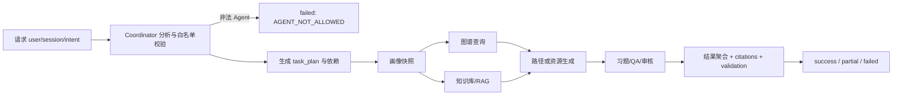
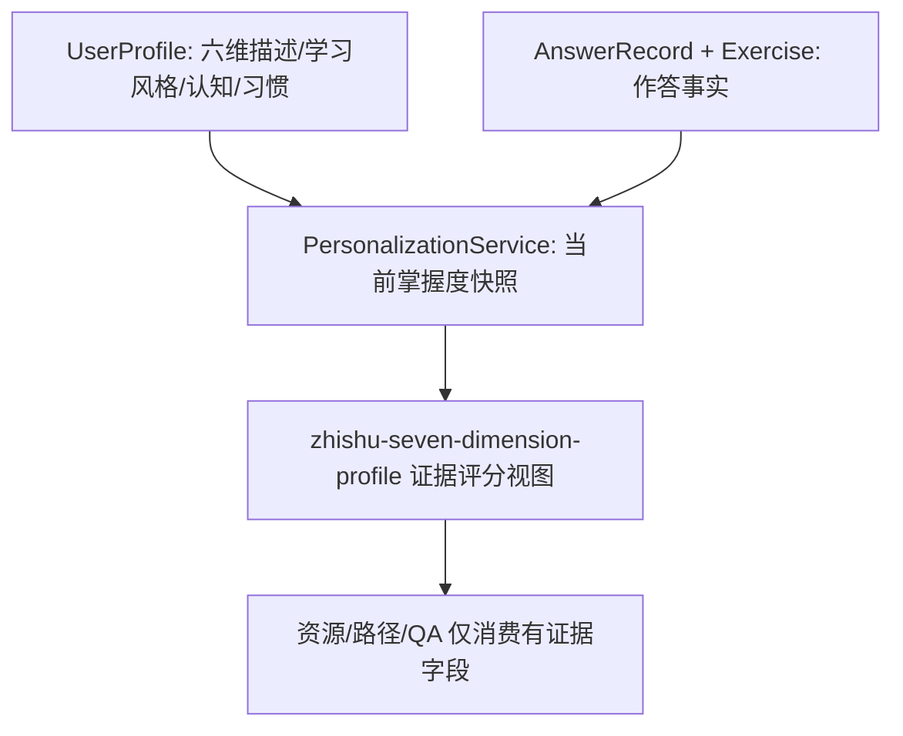

# ZhiShu 融合后的目标架构

## 1. 责任边界

当前 FastAPI 多服务和 Vue 3 前端仍是运行基线：

| 层 | 主责任 | 本次融合 |
|---|---|---|
| Vue 3 | 页面、认证状态、加载/部分失败展示、现有 SSE 工具 | 暂不新增页面；前端可读取协调返回的兼容状态 |
| user-service | 用户、画像事实、画像对话和权限 | 保持 `UserProfile` 主数据不变 |
| agent-service | Coordinator、画像快照、RAG、图谱、资源/习题/QA | 增加兼容画像视图、任务状态和 Agent 调用摘要 |
| evaluation-service | 答题事实、错题、报告和建议 | 仍是报告事实来源，不由 LLM 改写统计值 |
| resource-service | 资源持久化、交互、推荐 | 保持现有混合推荐，不建立第二套推荐器 |
| teacher/system-service | 班级范围、管理员配置和审计 | 不向学生暴露内部调用摘要或敏感日志 |

## 2. 统一任务状态



协调状态对外以兼容字段表达：

```json
{
  "task_id": "uuid",
  "session_id": "optional-session-id",
  "intent": "生成课件和练习",
  "intent_params": {},
  "selected_agents": ["learner_profiling_agent", "resource_generation_agent"],
  "task_plan": [{"agent": "resource_generation_agent", "status": "pending", "depends_on": ["learner_profiling_agent"]}],
  "status": "success",
  "progress": 1.0,
  "current_step": "任务完成",
  "error": null,
  "agent_calls": [{"agent": "resource_generation_agent", "version": "coordinator-local-v1", "output_status": "completed", "elapsed_ms": 12.3, "retries": 0}]
}
```

`agent_calls.input_summary` 仅允许字段名和布尔存在性摘要；完整 Prompt、Authorization、API Key、私密对话和模型内部推理不进入普通日志。当前同步编排仍是同步请求语义；异步 RabbitMQ 分发只返回 queued 元数据，不能被误读为 Agent 已完成。

## 3. 画像兼容层



当前评分算法版本为 `zhishu-scoring-v3`。知识掌握、理解和应用使用真实答题的正确性/评分、难度、题型、证据来源和时间衰减；记忆只使用同题重复后的后续表现；持续作答只使用有效耗时和超时标记。学习目标只评分“描述清晰度”，不评分达成概率。想象力要求持久化的开放题创意/多样性 rubric；当前没有该字段时返回 `source=insufficient_evidence`。所有维度都带 `sample_size`、`evidence_ids`、`evidence_window`、`source`、`confidence` 和 `status`，不会把正确率冒充为通用认知能力。

User Service 暴露 `GET /users/{user_id}/profile/zhishu`，普通画像响应也增加可选的 `zhishu_profile` 字段；两者和 Agent Service 的 `PersonalizationService` 使用同一个 `common.profile_scoring` 实现。

## 4. 依赖与失败隔离

- 画像先于依赖画像的路径、资源、习题和 QA。
- 图谱和知识库是可独立查询的前置上下文；现有同步代码按服务能力执行。
- 资源生成完成后才进行已有图谱同步与配套习题生成。
- 显式 Agent 必须属于 `SUPPORTED_AGENTS`；未知名称在分发前失败。
- 已有 Agent 产出继续使用 `status=completed/partial/failed`；Coordinator 聚合 `partial`，不把失败伪装成成功。
- 失败原因分为用户可理解的 `error/user_message` 与不进入普通日志的原始错误；`agent_calls.error_code` 只保存结构化错误码。

## 5. 数据和缓存原则

本次未新增表，也未改变现有 ID、权限或事实来源。画像兼容视图为请求期派生结果；画像、答题、路径和资源缓存仍由既有服务负责失效。若未来需要持久化算法版本、证据窗口或历史重建，应另开 Alembic 迁移并先验证 SQLite WAL 与 PostgreSQL 事务行为。
