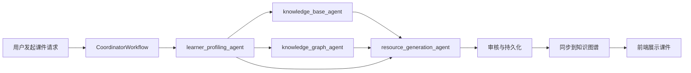
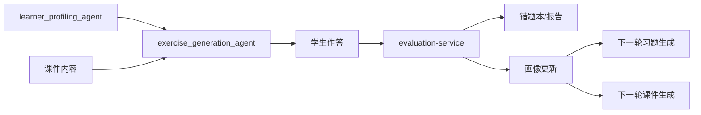
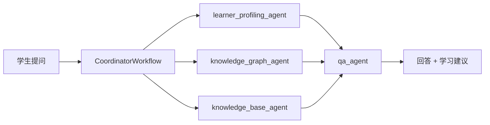
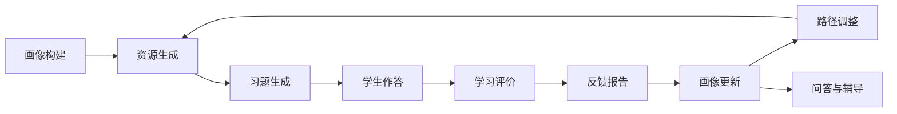

# 基于大模型的个性化资源生成与学习多智能体系统 PPT详细大纲

本大纲按当前 `workspace/slides/slide01.html` 到 `slide16.html` 的顺序组织，目标是让整套 PPT 能够完整说明：

- 系统为什么要做
- 每个功能模块解决什么问题
- 每个智能体分别负责什么
- 智能体之间如何共享上下文、前后接力、形成闭环

---

## 1. 封面页

**对应页**：`slide01`

**标题建议**

基于大模型的个性化资源生成与学习多智能体系统

**这一页要讲什么**

- 项目名称、项目定位、核心关键词
- 关键词建议突出：大模型、多智能体、个性化学习、RAG、知识图谱、学习闭环
- 用一句话概括系统价值

**建议讲稿**

本项目面向个性化学习场景，构建了一个以大语言模型为核心、以多智能体协作为组织方式、以学习者画像、知识库和知识图谱为支撑的智能学习平台。系统能够围绕学生的真实学习状态，自动生成课件、习题、学习路径、学习反馈，并通过答疑和持续评估形成动态优化闭环。

---

## 2. 目录页

**对应页**：`slide02`

**这一页要讲什么**

- 告诉老师后续汇报结构
- 从“背景 -> 架构 -> 功能 -> 协作 -> 创新 -> 总结”展开

**建议目录顺序**

1. 项目背景与目标
2. 系统总体架构
3. 多智能体协调系统
4. 个性化资源生成
5. 智能习题生成
6. 智能问答系统
7. 大小模型协作聊天
8. 学习路径规划
9. 知识图谱
10. 学习评价与报告
11. 学习者画像系统
12. 多角色前端界面
13. 技术亮点与创新
14. 总结与展望

---

## 3. 项目背景与目标

**对应页**：`slide03`

**核心作用**

说明项目要解决的真实问题，并引出为什么必须使用“多智能体协作”而不是单次大模型生成。

**建议拆成 3 个问题**

1. 学习资源高度统一，难以适配不同学生
2. 学习、练习、评价、反馈之间缺少数据闭环
3. 单一大模型直接生成内容不稳定，容易缺少依据和个性化

**系统目标**

1. 构建动态学习者画像
2. 生成个性化课件、习题、学习路径
3. 用知识库和知识图谱增强生成依据
4. 让答题结果反哺后续推荐，形成持续优化闭环

**这一页要强调的协作关系**

- 学习者画像决定资源生成方式
- 知识库和图谱为内容生成提供依据
- 评价结果回流到画像，驱动下一轮协作

**建议讲稿**

这个项目并不是简单做一个“AI聊天”系统，而是希望把学习资源生成、练习、答疑、评价和推荐串联起来。我们最终追求的是“面向学生个体差异的动态教学支持”，因此系统必须具备跨模块协同能力，这也是多智能体设计的必要性。

---

## 4. 系统总体架构

**对应页**：`slide04`

**核心作用**

从整体上解释系统由哪些服务构成，各服务分别承担什么职责，智能体服务为什么是核心。

**建议讲解结构**

### 4.1 前后端分离 + 微服务架构

- 前端：Vue 3 + TypeScript + Element Plus
- 后端：FastAPI 多服务
- 多库协同：PostgreSQL、Neo4j、ChromaDB、Redis、RabbitMQ、MinIO

### 4.2 六个服务的作用

1. `user-service`
   负责注册登录、认证鉴权、学习者画像读写、画像对话采集
2. `agent-service`
   系统核心，负责多智能体编排、课件生成、习题生成、路径规划、QA、图谱查询、知识库检索
3. `resource-service`
   负责学习资源存储、查询、导出、管理
4. `evaluation-service`
   负责答题评分、错题本、学习报告、画像更新
5. `teacher-service`
   负责教师工作台、教学范围设定、班级视角管理
6. `system-service`
   负责系统配置、审计、用户角色管理

### 4.3 基础设施作用

- PostgreSQL：业务数据主库
- Neo4j：知识点依赖关系
- ChromaDB：RAG向量检索
- RabbitMQ：异步任务分发
- Redis：缓存
- MinIO：文件资源存储

**这一页要强调的协作关系**

- `agent-service` 是协作中枢
- `user-service` 提供个性化上下文
- `evaluation-service` 提供反馈数据回流
- `teacher-service` 提供教学范围约束
- `resource-service` 负责生成结果的持久化和展示出口

**建议讲稿**

从架构上看，系统并不是让一个大模型包办所有功能，而是通过独立服务分工协作。其中 `agent-service` 是核心调度层，它像“总协调器”一样连接用户画像、知识库、知识图谱、资源生成、习题生成和评价反馈，保证每个智能体只做自己最擅长的一部分。

---

## 5. 多智能体协调系统

**对应页**：`slide05`

**核心作用**

详细讲清楚“多智能体如何被选择、如何执行、如何共享上下文、如何处理冲突”。

### 5.1 协调器定位

协调器 `CoordinatorWorkflow` 是整个智能体系统的入口，负责：

1. 理解请求意图
2. 选择需要参与的智能体
3. 安排执行顺序
4. 汇总结果
5. 在必要时处理冲突和降级

### 5.2 三个核心节点

1. `analyze_intent`
   根据 `intent`、`force_agents`、关键词和执行模式选择智能体
2. `dispatch_tasks`
   支持异步队列分发，也支持同步串行执行
3. `resolve_conflicts`
   解决资源生成与反馈评估等先后顺序问题

### 5.3 九类核心智能体及作用

1. `learner_profiling_agent`
   分析学生掌握度、学习风格、薄弱点和偏好
2. `knowledge_graph_agent`
   提供知识点前置依赖、后续推荐和图谱可视化数据
3. `knowledge_base_agent`
   提供知识库文章检索、摘要和 grounding 内容
4. `path_planning_agent`
   生成阶段化学习路径和每日任务
5. `resource_generation_agent`
   生成个性化课件和学习材料
6. `exercise_generation_agent`
   生成结构化练习题
7. `qa_agent`
   提供学习问答、错因分析和下一步建议
8. `evaluation_feedback_agent`
   综合各上游智能体输出和评估数据，生成统一反馈
9. `audit_agent` / `AuditService`
   检查 AI 生成的课件和习题是否严重偏离用户需求、存在明显学术错误、空内容/乱码，以及价值观或安全风险；不通过时返回 REJECT 原因并打回生成智能体重新生成

### 5.4 智能体协作方式

- 显式指定协作：前端通过 `force_agents` 精确控制参与者
- 意图自动路由：协调器根据请求内容自动选取智能体组合
- 全系统协作：当用户需要全链路分析时，九个智能体全部参与，其中审核智能体作为生成内容进入前端前的质量闸门

### 5.5 上下文共享机制

协调器会把画像摘要、个性化提示、薄弱题型、知识依赖、历史错题等信息通过 `agent_handoff` 传给下游智能体。

**这一页要重点说明的协作链**

1. 协调器不是自己生成内容，而是“拆任务 + 调智能体 + 汇总结果”
2. 学习者画像通常是大多数链路的第一站
3. 图谱、知识库、资源、练习、问答、反馈之间是串联关系而不是孤立模块

**建议讲稿**

多智能体系统的关键不在于“智能体数量多”，而在于每个智能体职责清晰、上下游关系明确。我们的协调器先分析意图，再把任务拆给最合适的智能体，并通过共享上下文减少重复推理，让协作链路既可扩展，也更容易追踪和解释。

---

## 6. 个性化资源生成

**对应页**：`slide06`

**核心作用**

解释系统如何围绕某个知识点，为当前学生生成个性化课件。

### 6.1 功能作用

- 自动生成适合当前学生的课件或学习资料
- 不只生成“知识点介绍”，还会考虑学生基础、偏好和常见错误
- 输出结构化 Markdown，可直接展示和保存

### 6.2 生成流程

1. 知识点标准化
2. 推断资源类型与难度
3. RAG 检索知识库片段
4. 构建学习者画像快照
5. 构建生成计划 `generation_plan`
6. 调用 LLM 生成正式课件
7. 通过审核智能体检查质量、主题匹配、学术正确性和价值观/安全风险；不通过则打回重生成
8. 持久化到资源库，并同步到知识图谱

### 6.3 这个功能的价值

- 同一知识点，不同学生生成内容不同
- 保证内容有知识依据，而不是纯模型自由发挥
- 生成后还能进入后续图谱、路径、问答等环节继续复用

### 6.4 涉及的智能体协作

1. `learner_profiling_agent`
   提供学生掌握度、兴趣方向、认知偏好
2. `knowledge_base_agent`
   提供知识库文章摘要、核心概念、易错点
3. `knowledge_graph_agent`
   提供前置知识和关联资源，帮助保证知识结构合理
4. `resource_generation_agent`
   根据上述信息生成课件

### 6.5 典型协作链路

用户请求生成课件  
`-> learner_profiling_agent` 获取个性化上下文  
`-> knowledge_base_agent` 检索支撑材料  
`-> knowledge_graph_agent` 检查前置依赖  
`-> resource_generation_agent` 生成课件  
`-> audit/persist` 审核并保存  
`-> knowledge_graph_agent` 同步图谱关系

**建议讲稿**

资源生成不是“给一个题目让大模型直接写”，而是先做规划、再做检索、再做个性化注入。这样生成出来的课件既能贴合学生的真实水平，也能保持知识结构和内容依据。

---

## 7. 智能习题生成

**对应页**：`slide07`

**核心作用**

说明系统如何根据知识点和学生画像生成结构化练习题，并与评价闭环打通。

### 7.1 功能作用

- 自动生成练习题组
- 支持多题型、多难度分布
- 能围绕学生薄弱点定向出题
- 与错题本和画像更新直接联动

### 7.2 支持的题型

1. 选择题
2. 填空题
3. 判断题
4. 简答题
5. 编程题

### 7.3 难度控制策略

- 60% 基础题
- 30% 进阶题
- 10% 挑战题

### 7.4 质量控制

- 去重机制：避免与历史题目重复
- 输出审计：修复格式问题
- 回退机制：LLM 失败时切换模板化备选题

### 7.5 涉及的智能体协作

1. `learner_profiling_agent`
   提供薄弱题型、学习速度、错误偏好
2. `resource_generation_agent`
   可提供刚生成课件中的知识结构，帮助习题紧贴当前课程内容
3. `exercise_generation_agent`
   负责具体题目生成、难度分布和解析输出
4. `evaluation-service`
   在学生作答后评分，并把结果回流画像

### 7.6 典型协作链路

画像分析  
`-> exercise_generation_agent` 定向生成题组  
`-> 学生作答`  
`-> evaluation-service` 判分和错因记录  
`-> learner_profiling_agent` 更新掌握度  
`-> 下次资源/路径/习题生成时复用最新画像`

**建议讲稿**

习题生成的关键不是“能出题”，而是“能围绕学生当前短板出题，并把做题结果再用回来”。因此这个模块本质上连接了资源生成、学习评价和画像更新，是学习闭环中的核心桥梁。

---

## 8. 智能问答系统

**对应页**：`slide08`

**核心作用**

说明问答系统不仅回答问题，还能结合学习上下文给出诊断和建议。

### 8.1 功能作用

- 回答学生知识性问题
- 识别知识缺口
- 根据当前学习阶段给出下一步建议
- 支持将问答结果与学习资源、练习和路径联动

### 8.2 两类问答场景

1. 一般知识问答
   以 `qa_agent` 为主
2. 学习分析型问答
   由画像、图谱和 QA 联合完成

### 8.3 典型输入上下文

- 当前问题
- 当前学习路径
- 当前知识点
- 历史错题
- 学习者画像
- 相关知识库片段

### 8.4 涉及的智能体协作

1. `knowledge_base_agent`
   提供 grounding 内容
2. `knowledge_graph_agent`
   提供当前知识点的前置知识和关联知识
3. `learner_profiling_agent`
   提供学生背景和理解偏好
4. `qa_agent`
   负责给出自然语言回答和结构化分析

### 8.5 协作价值

- 同一个问题，系统会根据学生基础调整解释深浅
- 如果判断学生缺少前置知识，问答会转向补基础而不是只给答案
- 问答结果可以继续触发课件生成或习题推荐

**建议讲稿**

这个模块和通用聊天机器人最大的区别在于，它不是只看“你问了什么”，还看“你是谁、你学到哪、你卡在哪”。因此它给出的回答更像一个懂上下文的教学助理。

---

## 9. 大小模型协作聊天

**对应页**：`slide09`

**核心作用**

解释系统如何在成本、速度和回答质量之间做平衡。

### 9.1 功能作用

- 简单问题优先快速响应
- 复杂问题再调用大模型深入分析
- 保证用户体验的同时降低调用成本

### 9.2 协作逻辑

1. 先判断问题复杂度
2. 简单问题走小模型或轻量检索
3. 复杂问题走大模型
4. 输出统一回到聊天会话中

### 9.3 适合强调的优势

- 响应更快
- 成本更低
- 大模型资源用于真正复杂的问题
- 适合高频教育场景

### 9.4 涉及的智能体协作

1. `qa_agent`
   负责问答主流程
2. `learner_profiling_agent`
   让路由时考虑学生背景
3. `knowledge_base_agent`
   为轻量问题提供直接 grounding

**建议讲稿**

教育场景中的大量问题其实并不都需要最强模型来回答。我们通过大小模型协作，把复杂分析留给大模型，把高频简单问题交给轻量链路处理，从而实现速度、成本和质量之间的平衡。

---

## 10. 学习路径规划

**对应页**：`slide10`

**核心作用**

说明系统如何把“知道学生情况”转化成“具体可执行的学习安排”。

### 10.1 功能作用

- 生成阶段化学习路径
- 为学生拆出每日任务
- 根据学生基础动态调节节奏和难度
- 支持教师教学范围约束

### 10.2 规划逻辑

1. 读取学习者画像
2. 分析知识点依赖关系
3. 结合目标知识点和教师范围
4. 生成 3 到 4 天的阶段化学习路径
5. 输出每日任务、资源建议、练习建议

### 10.3 路径通常包含的阶段

1. 概念构建
2. 练习强化
3. 复盘提升

### 10.4 涉及的智能体协作

1. `learner_profiling_agent`
   决定节奏快慢、目标导向和难度层次
2. `knowledge_graph_agent`
   提供前置知识和推荐学习顺序
3. `path_planning_agent`
   输出具体学习路径
4. `teacher-service`
   提供教学范围和教学目标约束

### 10.5 协作价值

- 保证“先学什么，后学什么”有逻辑依据
- 路径不只考虑知识结构，也考虑学生个体差异
- 能兼顾学生个性化与教师教学计划

**建议讲稿**

路径规划模块把图谱中的知识结构和画像中的个体差异结合起来，让系统不仅能生成内容，还能告诉学生“现在最该学什么、今天该做什么、接下来怎么学”。

---

## 11. 知识图谱

**对应页**：`slide11`

**核心作用**

说明知识图谱不是单独展示用的，而是为生成、规划、问答提供结构化知识支撑。

### 11.1 功能作用

- 表示知识点之间的依赖和推荐关系
- 提供可视化学习结构
- 支持生成前置知识判断和路径推理
- 帮助资源与知识点建立关联

### 11.2 图谱中的核心关系

1. `DEPENDS_ON`
   前置依赖
2. `RECOMMENDS`
   后续推荐
3. `ASSOCIATED_WITH`
   关联资源

### 11.3 图谱数据来源

- 课件内容自动抽取
- 知识点元数据
- 资源与知识点绑定结果

### 11.4 涉及的智能体协作

1. `knowledge_graph_agent`
   负责图谱查询、依赖分析和可视化数据输出
2. `resource_generation_agent`
   生成课件后把知识点关系同步回图谱
3. `path_planning_agent`
   使用图谱关系规划顺序
4. `qa_agent`
   使用图谱提供前置知识解释

### 11.5 协作价值

- 让大模型输出更符合学科结构
- 避免跳过前置知识直接讲难点
- 让学习路径和答疑具有“结构感”

**建议讲稿**

知识图谱在这里不是孤立模块，它相当于整个系统的结构化知识骨架。资源生成、路径规划、智能问答都可以从图谱中获得“先后顺序”和“关联关系”，这能显著提高教学逻辑性。

---

## 12. 学习评价与报告

**对应页**：`slide12`

**核心作用**

说明系统如何把学生的作答行为转成可解释的评估结果，并反馈给后续协作链路。

### 12.1 功能作用

- 对学生作答进行自动评分
- 形成错题本和错因统计
- 生成阶段、月度和综合报告
- 把结果回流到学习画像和路径调整

### 12.2 评价内容

- 正确率
- 作答耗时
- 薄弱知识点
- 常错题型
- 学习趋势

### 12.3 涉及的服务与智能体协作

1. `evaluation-service`
   负责评分、记录、统计和报告生成
2. `learner_profiling_agent`
   读取评价结果更新掌握度和学习偏好判断
3. `path_planning_agent`
   根据评价结果调整后续任务
4. `evaluation_feedback_agent`
   汇总各智能体输出形成统一反馈

### 12.4 典型闭环

学生完成习题  
`-> evaluation-service` 判分  
`-> 生成错题和统计`  
`-> learner_profiling_agent` 更新画像  
`-> path_planning_agent` 调整学习路径  
`-> resource_generation_agent` 下轮生成更适配的内容

**建议讲稿**

评价模块不是结束点，而是下一轮个性化生成的起点。它让系统真正形成“生成资源 -> 学生练习 -> 系统评估 -> 再次优化”的持续闭环。

---

## 13. 学习者画像系统

**对应页**：`slide13`

**核心作用**

说明画像系统是整个个性化协作链路的起点和基础。

### 13.1 功能作用

- 构建学生的动态学习画像
- 为课件、习题、路径和问答提供个性化依据
- 持续根据学习行为自动更新

### 13.2 六个核心维度

1. `knowledgeBase`
   知识基础
2. `cognitiveStyle`
   认知风格
3. `errorPreference`
   错误偏好
4. `learningSpeed`
   学习速度
5. `interestDirection`
   兴趣方向
6. `goalOrientation`
   目标导向

### 13.3 画像构建流程

1. 对话采集
2. 语义解析
3. 维度抽取
4. 画像更新
5. 生成分析摘要

### 13.4 三阶段对话式处理链

1. Parser Agent
   提取显式信息和隐含意图
2. Analysis Agent
   结构化分析并判断置信度
3. Output Agent
   生成自然语言反馈，继续引导对话

### 13.5 对下游智能体的支持

- 给资源生成智能体提供内容偏好
- 给习题生成智能体提供薄弱点和学习速度
- 给路径规划智能体提供目标导向和节奏
- 给 QA 智能体提供解释风格偏好

**建议讲稿**

画像系统就像整个系统的“个性化引擎”。如果没有画像，系统只能生成通用资源；有了画像之后，系统才能知道学生是基础薄弱还是希望进阶，是偏好图解还是偏好实操，从而让所有后续智能体都具备个体化能力。

---

## 14. 多角色前端界面

**对应页**：`slide14`

**核心作用**

说明系统不仅后端协作完整，前端也围绕不同角色提供了可落地的使用入口。

### 14.1 学生端作用

- 查看学习路径
- 生成并学习课件
- 练习作答
- 查看错题本和学习报告
- 进行智能问答
- 查看知识图谱和画像分析

### 14.2 教师端作用

- 管理班级
- 查看学生学习情况
- 设置教学范围
- 审核或发布课件
- 从班级视角看整体掌握情况

### 14.3 管理员端作用

- 管理学科和角色
- 管理系统配置
- 查看审计日志

### 14.4 这一页要强调的协作关系

- 学生端是多智能体协作结果的主要承接界面
- 教师端通过“教学范围”参与个性化协作约束
- 管理员端保证系统稳定运行和权限安全

**建议讲稿**

前端并不是简单把后端接口拼起来，而是把多智能体协作结果转化成学生、教师和管理员都能直接使用的工作台。特别是教师范围设定和学生画像展示，让系统既有智能性，也有教学可控性。

---

## 15. 技术亮点与创新

**对应页**：`slide15`

**核心作用**

总结本项目相较于普通大模型应用的差异化价值。

### 15.1 建议突出 6 个亮点

1. 多智能体协作编排
   不是单模型一次性生成，而是分工协作
2. 学习者画像驱动个性化
   所有生成链路都围绕学生画像展开
3. RAG + 知识图谱双重增强
   同时提供语义依据和结构依据
4. 大小模型协作
   平衡速度、质量和成本
5. 学习闭环
   资源、练习、评价、报告、再推荐形成循环
6. 多级降级机制
   LangGraph、消息队列、模型调用、图谱查询均有回退方案

### 15.2 这一页重点讲的“协作价值”

- 协作让系统更稳定
- 协作让功能更可扩展
- 协作让结果更可解释
- 协作让系统更贴近真实教学流程

**建议讲稿**

这个项目最大的创新点不是“用了大模型”，而是把大模型组织进了一个有结构、有上下游、有反馈回路的教育系统里。多智能体协作、RAG、知识图谱和学习闭环共同构成了系统的核心竞争力。

---

## 16. 总结与展望

**对应页**：`slide16`

**核心作用**

收束全篇，回到系统价值、当前成果和未来可扩展方向。

### 16.1 总结建议

- 已构建完整的个性化学习多智能体系统
- 已实现课件、习题、路径、问答、评价、画像、图谱的联动
- 已形成从学习行为到个性化再生成的闭环

### 16.2 展望建议

1. 引入更细粒度的知识追踪模型
2. 扩展更多学科知识库和教学资源
3. 强化教师端干预与协同编辑能力
4. 增加多模态资源生成能力
5. 增强长期学习行为预测和推荐能力

**建议讲稿**

总体来说，本项目已经实现了一个面向教育场景的多智能体协作系统原型。未来可以继续向更细粒度的学习诊断、更丰富的多模态资源、更强的教师协同和更长期的个性化推荐方向演进。

---

## 附录 A：全系统智能体协作总览

这一部分适合答辩时在“多智能体协调系统”页或“技术亮点”页展开讲。

### A.1 全智能体职责总表

| 智能体 | 主要输入 | 核心作用 | 主要输出 | 下游协作对象 |
|------|------|------|------|------|
| learner_profiling_agent | 用户画像、答题记录、行为数据 | 构建学习者快照 | 掌握度、偏好、薄弱点、handoff | resource / exercise / path / qa / feedback |
| knowledge_graph_agent | 知识点、课件内容、图谱请求 | 提供依赖关系和资源关联 | dependencies、related_resources、visualization | path / qa / resource |
| knowledge_base_agent | 查询词、知识点、文章ID | 提供 grounding 内容 | 文章摘要、概念、易错点 | resource / qa / exercise |
| path_planning_agent | 画像、知识点、时间约束 | 生成学习路径 | 阶段计划、每日任务 | frontend / feedback |
| resource_generation_agent | 画像、知识库、图谱、主题 | 生成课件 | 正式课件、生成计划 | graph / frontend / exercise |
| exercise_generation_agent | 画像、课件、知识点 | 生成题组 | 结构化习题、答案、解析 | evaluation / frontend |
| qa_agent | 问题、画像、图谱、知识库 | 问答与学习分析 | 自然语言回答、结构化建议 | frontend / resource / exercise |
| evaluation_feedback_agent | 上游智能体结果、评估数据 | 综合反馈 | 个性化报告、改进建议 | frontend / path / profile |

### A.2 智能体共享上下文的核心内容

- 学习者掌握度
- 最近错题
- 学习风格
- 学习速度
- 兴趣方向
- 目标导向
- 当前知识点的前置依赖
- 检索到的知识库片段
- 当前学习路径阶段

---

## 附录 B：典型协作流程图

### B.1 课件生成协作流程

### B.2 习题生成与反馈闭环

### B.3 问答协作流程

### B.4 全系统闭环

---

## 附录 C：答辩时最值得强调的 4 条主线

### 主线 1：为什么必须是多智能体

- 单一大模型难以同时承担画像分析、知识检索、路径规划、内容生成和综合反馈
- 拆分为多个智能体后，职责清晰、结果更稳定、可解释性更强

### 主线 2：为什么能做到个性化

- 系统不是只看知识点，而是始终先读取学习者画像
- 学生的基础、速度、偏好、目标都会影响生成结果

### 主线 3：为什么结果更可靠

- RAG 提供知识依据
- 知识图谱提供结构依据
- 审核服务提供质量控制

### 主线 4：为什么能形成闭环

- 学习资源不是一次性输出
- 学生作答后会更新画像
- 更新后的画像继续影响下一轮资源、习题、路径和答疑
